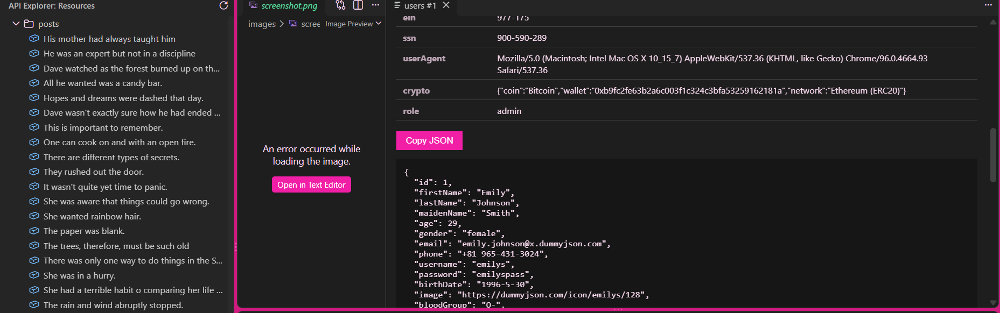

# API Explorer

Browse any REST API from the VS Code sidebar. Pick a base URL, choose which endpoints to show, and open any record in a detail panel without leaving your editor.

## Features

- **Import from OpenAPI or Swagger.** Paste a spec URL, tick the endpoints you want, and the tree fills itself.
- **Sidebar tree view** of the endpoints you choose, loaded lazily when you expand a folder.
- **Detail panel** that opens beside your code with the record's fields in a table, plus a Copy JSON button.
- **Works with any JSON API.** Handles plain arrays, wrapped results like `{ "products": [...] }`, and single objects.
- **Token support.** Call private APIs with a token stored in your operating system's keychain, never in a settings file.
- **Status bar shortcut** showing the current base URL. Click it to change it.
- **Friendly errors** with a 10 second timeout, so a slow or broken API never freezes the editor.

## Getting started

1. Click the **API Explorer** icon in the Activity Bar.
2. Expand a folder to load its items, or click **Import from OpenAPI** if the tree is empty.
3. Click an item to open its details.

The default setup uses the free demo API at `jsonplaceholder.typicode.com`.

## Import from OpenAPI or Swagger

1. Click the cloud icon in the tree header, or run **API Explorer: Import from OpenAPI**.
2. Paste the URL of a JSON spec, for example `https://petstore3.swagger.io/api/v3/openapi.json`.
3. Tick the endpoints you want to browse.
4. If the spec names a server address, you are asked whether to set it as the base URL.

The import replaces your `apiExplorer.resources` list. Only simple GET endpoints are offered: paths with placeholders such as `/pets/{id}` and endpoints with required parameters are skipped. The spec download never includes your token.

Supported today: OpenAPI 3.x and Swagger 2.0 as JSON, up to 5 MB. YAML specs are not supported yet.

Some APIs use GET for actions, such as a logout endpoint. Only tick endpoints that are safe to call.

## Using a private API

1. Set `apiExplorer.baseUrl` to your API, or import a spec.
2. Run **API Explorer: Set Token** and enter your token. It is stored in your OS keychain.
3. Expand a folder. If the API answers 401 or 403, the extension offers a one-click **Set Token** prompt.

## Settings

| Setting | Default | Description |
|---|---|---|
| `apiExplorer.baseUrl` | `https://jsonplaceholder.typicode.com` | Base URL of the API (user-level only, so a project cannot redirect your token) |
| `apiExplorer.authScheme` | `Bearer` | Prefix for the Authorization header, such as `Bearer` or `Token`. Leave empty to send the raw token |
| `apiExplorer.resources` | `["posts", "users", "todos"]` | Endpoints shown as folders, such as `products` or `users/1/posts` |
| `apiExplorer.queryString` | `_limit=20` | Query string added to every request, such as `limit=20` |

Example for another API: set the base URL to `https://dummyjson.com`, resources to `products` and `recipes`, and the query string to `limit=20`.

## Commands

- **API Explorer: Refresh** reloads the tree.
- **API Explorer: Import from OpenAPI** builds the endpoint list from a spec.
- **API Explorer: Set Base URL** changes the API.
- **API Explorer: Set Token** stores a token securely in your OS keychain.
- **API Explorer: Clear Token** removes the stored token.

## Security

- Tokens are stored with VS Code secret storage (your OS keychain), not in settings.
- The token is never sent over plain `http://`, except to `localhost`.
- The base URL cannot be overridden by workspace settings.
- Specs are treated as untrusted input: size limit, timeout, and no token sent when downloading.
- The detail panel escapes all API data and uses a strict Content Security Policy.

## Limitations

- Read-only: only GET requests.
- OpenAPI import supports JSON only, and skips endpoints with placeholders or required parameters.
- One token for all endpoints.

## Requirements

Visual Studio Code 1.90 or newer.

## Feedback

Issues and ideas: https://github.com/NehaK745/api-explorer/issues